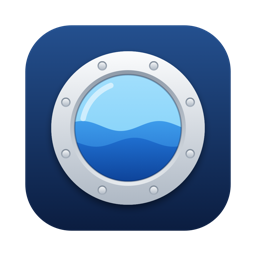

<h1 align="center">Porthole</h1>

Open your Tailscale devices straight from the Mac menu bar.

  <a href="https://github.com/codecohortinc/porthole/releases/latest/download/Porthole.zip"><b>Download for macOS</b></a>
  &nbsp;|&nbsp;
  <a href="#한국어">한국어</a>

Porthole lists every device on your tailnet in the menu bar. One click opens Screen Sharing, a file share, an SSH session, or Remote Desktop. There is nothing to configure: if Tailscale can see a device, Porthole shows it.

## Features

- **Automatic device list.** Devices come from Tailscale, so new machines appear on their own.
- **One click to connect.** Screen Sharing (VNC), Files (SMB), Terminal (SSH), Remote Desktop (RDP).
- **Status at a glance.** The number next to the menu bar icon is how many devices are online. Offline devices are dimmed.
- **Clear Tailscale warnings.** If Tailscale is not installed, not running, or needs a login, Porthole says so and offers a button to fix it.
- **Per-device settings.** Hide devices you never connect to, pick which service buttons to show, and set a user name for each device.
- **Manual devices.** Add machines outside your tailnet by address.
- **Quick actions.** Right-click a device to copy its address or an SSH command.
- **English and Korean UI.** Launch at login is supported.

## Requirements

- macOS 13 or later (Apple Silicon and Intel)
- [Tailscale](https://tailscale.com/download) installed and signed in

## Install

1. [Download Porthole.zip](https://github.com/codecohortinc/porthole/releases/latest/download/Porthole.zip) and unzip it.
2. Move `Porthole.app` to your Applications folder and open it.
3. A porthole icon appears in the menu bar. Porthole does not show in the Dock.

Porthole is signed with a Developer ID and notarized by Apple, so it opens without a Gatekeeper warning.

## How connections work

| Service | Opens with | Port on the remote device |
|---|---|---|
| Screen Sharing | macOS Screen Sharing | 5900 |
| Files | Finder (SMB) | 445 |
| Terminal | Terminal (SSH) | 22 |
| Remote Desktop | Your RDP app, such as Windows App | 3389 |

The matching service has to be turned on at the remote device. Porthole only opens the connection. It does not send your data anywhere, and its settings stay on your Mac in `~/.config/porthole/servers.json`.

## Feedback

Found a bug or want a feature? [Open an issue](https://github.com/codecohortinc/porthole/issues).

---

## 한국어

Porthole은 Tailscale에 연결된 내 기기를 Mac 메뉴바에서 바로 여는 앱입니다. 클릭 한 번으로 화면 공유, 파일 공유, SSH, 원격 데스크톱을 엽니다. 따로 등록할 것이 없고, Tailscale에 보이는 기기는 그대로 목록에 나옵니다.

### 기능

- **자동 기기 목록.** Tailscale에서 기기를 가져오므로 새 기기가 알아서 나타납니다.
- **클릭 한 번으로 연결.** 화면 공유(VNC), 파일(SMB), 터미널(SSH), 원격 데스크톱(RDP).
- **한눈에 보는 상태.** 메뉴바 아이콘 옆 숫자는 지금 접속할 수 있는 기기 수입니다. 꺼진 기기는 흐리게 나옵니다.
- **Tailscale 경고.** Tailscale이 설치되지 않았거나 꺼져 있거나 로그인이 필요하면 원인과 해결 버튼을 보여 줍니다.
- **기기별 설정.** 안 쓰는 기기를 숨기고, 보일 서비스 버튼과 접속 사용자 이름을 기기마다 정합니다.
- **직접 추가.** Tailscale 밖의 기기도 주소를 넣어 추가할 수 있습니다.
- **빠른 동작.** 기기를 오른쪽 클릭하면 주소나 SSH 명령을 복사합니다.
- **영어, 한국어 UI.** 로그인 시 자동 실행을 지원합니다.

### 필요한 것

- macOS 13 이상 (Apple Silicon, Intel 모두 지원)
- [Tailscale](https://tailscale.com/download) 설치 및 로그인

### 설치

1. [Porthole.zip을 내려받아](https://github.com/codecohortinc/porthole/releases/latest/download/Porthole.zip) 압축을 풉니다.
2. `Porthole.app`을 응용 프로그램 폴더로 옮기고 실행합니다.
3. 메뉴바에 현창 모양 아이콘이 생깁니다. Dock에는 나타나지 않습니다.

Developer ID로 서명하고 Apple 공증을 받은 앱이라 Gatekeeper 경고 없이 열립니다.

연결하려는 서비스는 상대 기기에서 켜져 있어야 합니다. Porthole은 연결을 열어 주기만 하고 데이터를 어디로도 보내지 않습니다. 설정은 내 Mac의 `~/.config/porthole/servers.json`에만 저장됩니다.

### 문의

버그나 기능 제안은 [이슈](https://github.com/codecohortinc/porthole/issues)로 남겨 주세요.

---

© 2026 CodeCohort Inc. All rights reserved.
